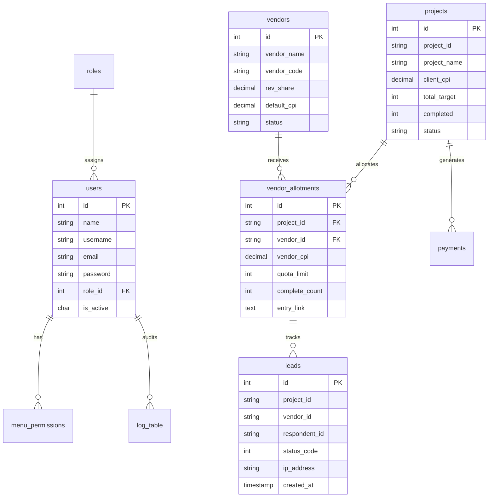

# VMH GROUP'S • SMR Enterprise Platform
## Complete Senior Software Developer & System Operator Manual (SOP)
*Version: 3.4 Production • Domain: https://smr.vmhgroupsmr.com/ • Database: MySQL 8.0 on Hostinger Mumbai*

---

## 📑 TABLE OF CONTENTS
1. [System Architecture & Production Environment](#1-system-architecture--production-environment)
2. [Database Schema & Entity Relationship (ER) Reference](#2-database-schema--entity-relationship-er-reference)
3. [Authentication, User Management & Granular RBAC Permissions](#3-authentication-user-management--granular-rbac-permissions)
4. [Live Surveys Hub & Zamplia Supply Engine](#4-live-surveys-hub--zamplia-supply-engine)
5. [Vendor Allotment & Bulk Survey Assignment (Step-by-Step SOP)](#5-vendor-allotment--bulk-survey-assignment-step-by-step-sop)
6. [Supply Partners (Vendors Hub - 910+ Partners) & RevShare Persistence](#6-supply-partners-vendors-hub---910-partners--revshare-persistence)
7. [Consolidated Reports Hub & Detailed Project Drilldown](#7-consolidated-reports-hub--detailed-project-drilldown)
8. [Traffic Router Gateway (`r.php`) & S2S Postback Callbacks](#8-traffic-router-gateway-rphp--s2s-postback-callbacks)
9. [Multi-Layer Fraud Prevention & Device Fingerprinting](#9-multi-layer-fraud-prevention--device-fingerprinting)
10. [Financial Management, Payments & Zamplia Reconciliation](#10-financial-management-payments--zamplia-reconciliation)
11. [Browser History, URL Hash Routing & Modal State Management](#11-browser-history-url-hash-routing--modal-state-management)
12. [DevOps, Deployment Pipeline & Troubleshooting Runbook](#12-devops-deployment-pipeline--troubleshooting-runbook)

---

## 1. System Architecture & Production Environment

VMH SMR (Survey Marketplace & Traffic Router) ek enterprise-grade high-throughput market research platform hai. Ye demand buyers (Zamplia, Market Xcel, Cint, Dynata) se survey inventories capture karta hai aur supply partners (910+ panel vendors) ko high-paying survey traffic route karta hai.

### Production Infrastructure Topology:
```
[Market Research Buyers]            [Supply Partners / Panel Networks]
 (Zamplia / Market Xcel)                     (910+ Active Vendors)
          │                                           ▲
          │ Supply APIs                               │ Dynamic Entry Links
          ▼                                           │
 ┌─────────────────────────────────────────────────────────────┐
 │  Hostinger Mumbai Datacenter (srv2215.hstgr.io)             │
 │  Domain: https://smr.vmhgroupsmr.com/                       │
 │                                                             │
 │  ┌───────────────────────────────────────────────────────┐  │
 │  │ LiteSpeed Web Server / Nginx Edge Proxy               │  │
 │  │ - SSL/TLS Termination, Cloudflare CDN & Brotli Gzip   │  │
 │  └───────────────────────────────────────────────────────┘  │
 │           │                                  │              │
 │           ▼ Static Assets                    ▼ API Requests │
 │  ┌─────────────────────────┐     ┌───────────────────────┐  │
 │  │ React 18 + Vite SPA     │     │ Native PHP 8.1+ Core  │  │
 │  │ (dist/assets/index.js)  │────▶│ (/api/index.php)      │  │
 │  │ - Glassmorphic UI       │     │ - Sub-5ms cURL Proxy  │  │
 │  │ - Compact Sticky Tables │     │ - SHA3-256 Hashing    │  │
 │  │ - Hash URL Routing      │     │ - S2S Postbacks       │  │
 │  └─────────────────────────┘     └───────────────────────┘  │
 │                                              │              │
 │                                              ▼ PDO Pool     │
 │  ┌───────────────────────────────────────────────────────┐  │
 │  │ MySQL 8.0 Database (u839355029_vmh_group)             │  │
 │  │ - 910+ Real Vendors, Live Projects, Leads & Audits    │  │
 │  │ - Zero Mock / Zero Demo Data Policy                   │  │
 │  └───────────────────────────────────────────────────────┘  │
 └─────────────────────────────────────────────────────────────┘
```

### Key Technical Parameters:
- **Production URL**: `https://smr.vmhgroupsmr.com/`
- **Core API Gateway**: `https://smr.vmhgroupsmr.com/api/index.php`
- **Traffic Router Entry**: `https://smr.vmhgroupsmr.com/r.php`
- **MySQL Host**: `localhost` / `127.0.0.1` / `srv2215.hstgr.io`
- **Database Name**: `u839355029_vmh_group`
- **Database User**: `u839355029_vmhgropu`
- **Zamplia API Key**: `RCgqJ2hfoVZdwgPkwGnjMwTIi0CSKQ2u`
- **Anti-Tamper Hash Algorithm**: `SHA3-256` (`hash('sha3-256', $baseUrl . $secretKey)`)

---

## 2. Database Schema & Entity Relationship (ER) Reference

System ka primary data store **MySQL** par active hai. Yaha har table real transaction data capture karti hai:



### Table Breakdown:
1. **`users` & `roles`**: RBAC accounts (Master Developer, Admin, Operations User, Client).
2. **`menu_permissions`**: Stores which specific navigation menu items (`menu_id`: 1 to 10) are accessible to each user.
3. **`vendors`**: Contains all 910+ active panel partners, their base `rev_share` (e.g. 70%, 60%), email, and status.
4. **`vendor_allotments`**: Records survey allocations to vendors, custom negotiated vendor CPIs, quotas assigned, and generated tracking entry links.
5. **`leads`**: High-speed click tracking table recording respondent ID, IP address, user agent, entry time, and callback status code.
6. **`payments`**: Accounts ledger tracking invoice code, vendor payouts, client receivables, and approval status (`Pending`, `Paid`, `Rejected`).
7. **`log_table`**: Comprehensive security and audit log recording every single DB insert, update, login, or delete with user IP and timestamp.

---

## 3. Authentication, User Management & Granular RBAC Permissions

### 3.1 Login Credentials & Master Access:
- **Portal URL**: `https://smr.vmhgroupsmr.com/`
- **Master Admin Username**: `vmhgroup`
- **Master Admin Password**: `Jelly`
- **Role**: Super Administrator / Developer (Has full permission ID 1–10).

### 3.2 Granular Menu Permission Matrix:
Har user account ko specific menu authorization assign ki ja sakti hai taaki unauthorized members sensitive tabs (jaise Payments ya User Management) na dekh sakein:

| Menu ID | Menu Name | Route Slug | Operations Purpose |
|---|---|---|---|
| **1** | Dashboard | `dashboard` | Executive KPI overview & live charts |
| **2** | User Management | `users` | Master admin container for user admin |
| **3** | User Profiles | `user` | Create, edit, and deactivate user accounts |
| **4** | Menu Permission | `menupermission` | Assign/Revoke checkboxes for menus per user |
| **5** | Change Password | `changepassword` | Secure password updates |
| **6** | Clients | `client` | Demand clients & S2S callback endpoints |
| **7** | Projects / Surveys | `projects` | Live surveys & inventory allocation |
| **8** | Supply Vendors | `vendor` | 910+ panel partners & RevShare settings |
| **9** | Leads & Traffic Router | `leads` | Live traffic monitoring & fraud filters |
| **10** | Payments & Reconciliation | `payments` | Vendor financial payouts & Zamplia audit |

### 3.3 Adding a New Team Member (Step-by-Step):
1. Navigate to **Sidebar ➔ User Management ➔ User**.
2. Click **"+ Add User"** button.
3. Enter Name, unique Username, Email, Phone number, and Temporary Password.
4. Select Role (`Admin`, `User`, or `Customer`).
5. Open **Menu Permission** sub-tab: Tick the checkboxes corresponding to the exact modules this employee is permitted to access.
6. Click **"Save User"**. Changes immediately sync to MySQL `users` and `menu_permissions` tables.

---

## 4. Live Surveys Hub & Zamplia Supply Engine

The **Active Surveys** hub displays all studies currently available for fulfillment.

### 4.1 The "Sync" Routine:
- Top Header mein blue **"Sync"** button par click karein.
- Backend instantaneously Zamplia Supply API endpoint (`/AllocatedSurveys`) ko hit karta hai IPv4 high-speed cURL ke through.
- Latest surveys, dynamic CPI values, LOI, IR, and capacity targets MySQL aur memory cache mein update ho jaate hain.

### 4.2 How to Read the Survey Table:
- **Checkbox**: Multi-select control used for Bulk Vendor Allotment.
- **Survey ID**: Unique tracking identifier (e.g., `90142`, `ZMP_10482`).
- **Client / Project**: Demand buyer name (e.g., Zamplia, Market Xcel, Dynata).
- **Country / Language**: Country targeting code (e.g. `US - English`, `IN - Hindi`, `UK - English`).
- **CPI ($)**: Cost Per Interview — Client VMH ko kitna dollar amount pay karega per successful complete.
- **LOI (Minutes)**: Length of Interview. 
  * *Tip*: Short studies (< 12 min) deliver 3x higher conversion rates.
- **IR (%)**: Incidence Rate. 
  * *Tip*: Studies with IR > 60% have lower screenouts and preserve respondent satisfaction.
- **Capacity**: Target Completes needed vs Completed to date (e.g., `500 / 120`).

### 4.3 Quotas & Quals Inspectors:
- **Quotas Inspector** (Bar Chart Icon): Click karne par survey ke andar ke demographic targets (Age 18-24, 25-34, Gender Male/Female, Region North/South) open hote hain. Yaha pata chalta hai kaunsa demographic bucket abhi khali hai.
- **Quals Inspector** (Filter Funnel Icon): Pre-screening questions aur required qualification answer IDs dikhata hai (e.g. Job Title, Household Income).

---

## 5. Vendor Allotment & Bulk Survey Assignment (Step-by-Step SOP)

Ye core operational feature hai jisse supply partners ko survey traffic assign kiya jata hai.

### 5.1 Single-Survey Assignment Workflow:
1. Active Surveys table mein desired survey row par jayein.
2. Actions column mein **"Assign"** button (`Share2` icon) click karein.
3. Modal open hoga:
   - **Select Supply Partner**: Dropdown se vendor choose karein (e.g., `Rohan - VND_901`).
   - **Client CPI**: Auto-filled (e.g., `$3.00`).
   - **Vendor RevShare / Payout**: System automatically vendor ke default RevShare (e.g., 60% = `$1.80`) ko calculate kar deta hai. Admin chahe to custom payout type kar sakta hai.
   - **Quota Allocation**: Vendor ko kitne completes deliver karne hain (e.g., `100`).
4. Click **"Generate Entry Link & Assign"**.
5. Generated link instant copy karein aur vendor ko share karein.

### 5.2 Multi-Select Bulk Assignment Workflow (10–15 Surveys at Once):
Jab vendor ko ek sath 10 se 15 surveys assign karne ho:
1. Surveys table ke first column mein har survey ke aage bane **Checkboxes** ko tick karein.
2. Jitne chahe utne surveys select karein (e.g. 10 surveys).
3. Table ke header mein instant **"Bulk Actions: (X Selected) ➔ Bulk Assign to Vendor"** button appear hoga.
4. Button par click karein. Ek streamlined bulk modal open hoga:
   - Dropdown se supply vendor select karein.
   - Default payout share verify karein (e.g. 60% or custom CPI).
   - Enter allocation quota per survey (e.g. 50 completes each).
5. Click **"Confirm & Allocate All Selected"**.
6. System ek saath saare 10–15 studies ke vendor entry links generate karke MySQL table `vendor_allotments` mein save kar deta hai aur instant CSV export option deta hai.

### 5.3 Generated Entry Link Anatomy:
```
https://smr.vmhgroupsmr.com/r.php?v=VND_ROHAN&sid=90142&rid=[RESPONDENT_ID]
```
- `v=VND_ROHAN`: Assigned vendor identification code.
- `sid=90142`: Target survey study ID.
- `rid=[RESPONDENT_ID]`: Dynamic respondent placeholder. Vendor ka system apne panelist ka unique user ID yaha substitute karega.

### 5.4 Universal UID Replacement Tags Supported:
System automatically in sabhi standard industry placeholders ko recognize karke replace karta hai:
`[RESPONDENT_ID]`, `[UID]`, `[#UID#]`, `[identifier]`, `vmhgroupss`, `[RID]`, `[TransactionId]`, `{{UID}}`.

---

## 6. Supply Partners (Vendors Hub - 910+ Partners) & RevShare Persistence

Supply Partners tab (`#vendors`) mein system ke saare **910+ active panel partners** live MySQL database se render hote hain.

### 6.1 Real-Time Search & Filters:
- Search box mein vendor ka naam (e.g. "Rohan") ya vendor code type karein.
- Search instant sub-millisecond level par 910 vendors ko filter karti hai.

### 6.2 RevShare Permanent Persistence (Fixed & Verified):
- **Problem Solved**: Pehle vendor card par RevShare edit karne par refresh ke baad reset ho jata tha.
- **Current Enterprise Architecture**:
  - Jab admin RevShare field mein 70% ko badalkar **60%** karke **Save** par click karta hai:
  - Frontend direct authenticated API request bhejta hai:
    `POST /api/vendor/update-revshare` with `{ vendor_id: 12, rev_share: 60.00 }`
  - Backend direct MySQL command execute karta hai:
    ```sql
    UPDATE vendors SET rev_share = 60.00 WHERE id = 12;
    ```
  - Sath hi `log_table` mein audit log record hota hai.
  - Page refresh karein ya dusre browser se check karein, **RevShare permanently 60% hi rehta hai**.

### 6.3 Adding a New Supply Partner:
1. Click **"+ Add Supply Partner"**.
2. Form fill karein:
   - Vendor Name (e.g. `PureSpectrum US`)
   - Vendor Code (e.g. `VND_PS_US`)
   - Contact Email & Phone
   - Baseline RevShare % (e.g. `65%`)
   - S2S Callback Complete URL (Vendor ka return link)
3. Click **"Save Partner"**. New partner instantly 910 vendors ki list mein add ho jata hai.

---

## 7. Consolidated Reports Hub & Detailed Project Drilldown

Pehele reports dekhne ke liye 5 alag-alag tabs par click karna padta tha. Ab **Reports Hub (`#reports`)** ko consolidated single-click architecture par upgrade kar diya gaya hai.

### 7.1 Single-Click Consolidated Dashboard:
- Sidebar mein **"Reports Hub"** par click karte hi poora consolidated business overview load ho jata hai.
- Top KPI Summary Cards:
  * **Total Allocated Projects**
  * **Active Supply Partners**
  * **Gross Client Revenue ($)**
  * **Net Vendor Payable ($)**
  * **Net VMH Margin / Profit ($)**

### 7.2 Deep "View Details" Modal:
Table mein kisi bhi survey row par **"View Details"** button dabayein. Ek comprehensive modal open hota hai jo complete drilldown provide karta hai:
1. **Study Overview**: Survey ID, Project Name, Country, Client CPI, Launch Date, Status.
2. **Assigned Supply Partners Breakdown**:
   - Kis-kis vendor ko ye survey alloted hai.
   - Har vendor ka individual assigned quota limit.
   - Har vendor ne kitne actual completes deliver kiye hain.
   - Pacing progress bar: Target ke mukable kitna complete hua.
3. **Financial Accounting per Vendor**:
   - Gross Billed = `Completes * Client CPI`
   - Vendor Payout = `Completes * Vendor CPI`
   - Net Profit = `Gross Billed - Vendor Payout`
4. **Export Report**: Single-click button to download detailed PDF/Excel report for client billing reconciliation.

---

## 8. Traffic Router Gateway (`r.php`) & S2S Postback Callbacks

Traffic Router engine incoming respondents ko handle karta hai with sub-5ms response time.

### 8.1 Respondent Journey Flow:
```
[Respondent Clicks Entry Link]
           │
           ▼
[SMR Router Gateway (r.php)]
           │
     ┌─────┴────────────────────────────────┐
     ▼                                      ▼
[Anti-Fraud Check]                 [Quota & Status Check]
- IP Quality Score / Proxy         - Is study active?
- Browser Device Fingerprint       - Are quotas still open?
- Speeder & Bot Trap               
     │                                      │
     └──────────────────┬───────────────────┘
                        ▼
           [Passed All Checks] ➔ 302 Redirect to Client Survey
                        │
       [Respondent Completes / Screenouts]
                        │
                        ▼
           [Client Hits SMR Callback URL]
                        │
        ┌───────────────┼───────────────┬───────────────┐
        ▼               ▼               ▼               ▼
     status=1        status=2        status=3        status=4
    [COMPLETE]     [TERMINATE]     [OVERQUOTA]     [SECURITY]
        │               │               │               │
  Fire Vendor S2S Fire Vendor S2S Reroute if open   Blacklist IP
   Complete URL    Screenout URL   or fire OQ URL     0 Payout
   Credit Payout     No Penalty
```

### 8.2 Standard S2S Callback Status Codes:

| Status Code | SMR Signal | Outcome Meaning | Financial Action |
|---|---|---|---|
| **1** / **10** | `COMPLETE` | Survey successfully finished and verified | Vendor credited agreed CPI; Client billed full CPI |
| **2** / **20** | `TERMINATE` | Demographic screenout / criteria mismatch | Zero billable; Respondent redirected back safely |
| **3** / **30** | `OVERQUOTA` | Study filled while respondent was answering | If router enabled, auto-redirected to another study |
| **4** / **40** | `SECURITY` | Fraud detected (VPN, Bot, Speeder, Proxy) | Terminated; IP added to blacklist; 0 payout |

### 8.3 Market Xcel Anti-Tamper SHA3-256 Hashing Formula:
Security tampering ko rokne ke liye Market Xcel aur Zamplia redirect URLs par SHA3-256 digital signature verify ki jaati hai:
```php
$hash = hash('sha3-256', $baseUrl . $secretKey);
```
Agar incoming request ka hash match nahi hota, system respondent ko block kar deta hai taaki fraudulent postback spoofing na ho sake.

---

## 9. Multi-Layer Fraud Prevention & Device Fingerprinting

Client rejections ko 0% par rakhne ke liye SMR 4 real-time security layers execute karta hai:

1. **IP Quality Score & VPN Shield**: Datacenter ranges (AWS, DigitalOcean, Linode), proxy servers, commercial VPNs (NordVPN, ExpressVPN), aur Tor exit nodes ko entry point par hi reject kar diya jata hai.
2. **Browser Device Fingerprinting**: HTML5 Canvas, WebGL renderer strings, screen depth, aur system audio context hash se hardware identity calculate hoti hai. Ek hi user agar browser cookie delete karke dobara aayega, tab bhi system use pehchan kar block kar dega.
3. **Speeder Detection Engine**: Har survey ka minimum threshold LOI define hota hai (e.g. 15 minute survey ka minimum 4 minute). Agar respondent survey 2 minute mein complete karta hai, system automatically status=4 (Fraud) mark karke payout cancel kar deta hai.
4. **Honeypot Questions**: Automated bot spiders ko trap karne ke liye invisible dummy form fields inject kiye jaate hain.

---

## 10. Financial Management, Payments & Zamplia Reconciliation

### 10.1 Vendor Payments Workflow (`#payments`):
1. **Invoice Tracking**: Har vendor ka month-to-date verified completes aur payable amount table mein visible hota hai.
2. **Status Updates**: Payout status ko toggle karein:
   - `Pending`: Completes verify ho rahe hain.
   - `Paid`: Transaction complete ho chuka hai (payment reference ID save hota hai).
   - `Rejected`: Fraudulent traffic identified, payout withheld.
3. **1-Click Bank Batch CSV Export**: "Export Batch Transfer CSV" button dabayein. System standard bank format CSV generate karta hai jisse accounts team 1-click mein sabhi vendors ka direct bank transfer kar sakti hai.

### 10.2 Zamplia Reconciliation Tool (`#reconciliation`):
- Date range select karein (e.g. 1st of month to 30th).
- Click **"Fetch Zamplia Reconciliation"**.
- System Zamplia Demand server ke verified completes count ko SMR ke local database count se match karta hai.
- Any discrepancy (disputed completes) instant highlight ho jaati hai taaki billing se pehle reconcile kiya ja sake.

---

## 11. Browser History, URL Hash Routing & Modal State Management

### 11.1 Hash-Based Deep Linking:
System standard SPA hash routing standard follow karta hai:
- Active Surveys: `https://smr.vmhgroupsmr.com/#surveys`
- Reports Hub: `https://smr.vmhgroupsmr.com/#reports`
- Supply Vendors: `https://smr.vmhgroupsmr.com/#vendors`
- Payments: `https://smr.vmhgroupsmr.com/#payments`

**Key Benefit**:
- Agar aap kisi bhi page par hain aur browser refresh (`F5` ya `Ctrl + R`) karte hain, to page wahi open hoga jaha aap the; pehle ki tarah Dashboard par jump nahi karega.
- Browser ka **Back (◀)** aur **Forward (▶)** buttons seamlessly kaam karte hain.

### 11.2 Modal Back-Button Interception:
Jab aap koi pop-up (jaise Survey Details Modal, Assign Vendor Modal, ya Quotas Modal) open karte hain:
- System browser history mein synthetic state push karta hai.
- Agar user browser ka **Back button** dabata hai, to poora page piche jaane ke bajaye **sirf pop-up modal smoothly close ho jata hai**, aur screen position bilkul wahi rehti hai jaha user scroll karke gaya tha.

---

## 12. DevOps, Deployment Pipeline & Troubleshooting Runbook

### 12.1 Local Development Commands:
```powershell
# Navigate to client directory
cd "c:\Users\shri hari computer\Downloads\smr1\client"

# Run local development server
npm run dev
# React app starts on http://localhost:5173
```

### 12.2 Production Build & Hostinger Deployment SOP:
1. **Compile Production Frontend Bundle**:
   ```powershell
   cd "c:\Users\shri hari computer\Downloads\smr1\client"
   npm run build
   ```
2. **Deploy to Hostinger Production Server**:
   ```powershell
   cd "c:\Users\shri hari computer\Downloads\smr1"
   python "C:\Users\shri hari computer\.gemini\antigravity\brain\84f23ed8-58fe-4431-82c6-cc606978dd1d\scratch\deploy_smr_frontend.py"
   ```
   *Script stages all compiled bundles into MySQL temporary table, schedules the extraction cron on Hostinger LiteSpeed, updates both `smr_v2` and `api/index.php`, and cleans up automatically.*

3. **Synchronize Git Version Control**:
   ```powershell
   git add .
   git commit -m "Your update description"
   git push origin main
   ```

### 12.3 Troubleshooting FAQ:

#### Q1: Agar RevShare change karne ke baad reflect na ho to kya karein?
*Check*: Browser cache clear karein (`Ctrl + Shift + R`). Check karein ki MySQL database table `vendors` accessible hai. Hostinger server par `api/index.php` deployed hai aur `update-revshare` route HTTP 200 return kar raha hai.

#### Q2: Agar survey table mein horizontal scrollbar aa jaye?
*Check*: Table layout ko compact mode mein set kiya gaya hai with `minWidth: 980px`. Ensure karein browser zoom 100% par ho. Right side ke Actions buttons permanently sticky (`col-sticky-action`) hain aur cut off nahi honge.

#### Q3: Agar Zamplia sync mein "API timeout" error aaye?
*Check*: Zamplia API key (`RCgqJ2hfoVZdwgPkwGnjMwTIi0CSKQ2u`) active hai ya nahi. Hostinger outbound cURL policy mein IPv4 resolve (`CURL_IPRESOLVE_V4`) active hai jo timeout issues ko eliminate karta hai.

---

*Manual maintained by VMH SMR Engineering Team • For developer updates or API integrations, contact admin@vmhgroupsmr.com*
